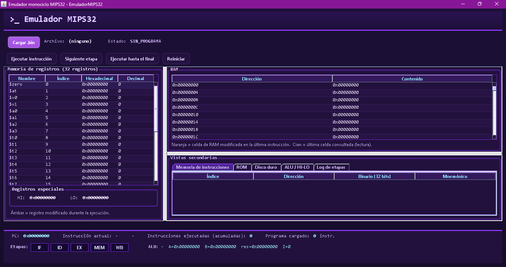

# EmuladorMIPS32

Emulador **monociclo** de un subconjunto de **MIPS32** con interfaz gráfica en Java
(Swing). Ejecuta programas ya ensamblados en archivos `.bin` (32 bits por
instrucción) y muestra, paso a paso, el estado interno del procesador: PC,
registros, ALU, memorias y las cinco etapas de ejecución.

> No incluye ensamblador. El emulador **consume** archivos `.bin`; no traduce
> texto ensamblador a código máquina.

---

## 1. Qué es

- Modelo de **un solo ciclo** por instrucción: cada instrucción recorre las etapas
  **IF → ID → EX → MEM → WB** (sin segmentación/pipeline).
- Arquitectura didáctica pensada para observar el estado del procesador.
- Interfaz gráfica que **solo lee estado** y solicita acciones; la lógica del
  procesador vive en las clases de `cpu`, `alu`, `execution`, `instruction` y
  `memory` (sin dependencias de Swing).
- Entrada: archivos `.bin` con palabras de 32 bits en **little-endian**
  (byte menos significativo primero).

---

## 2. Requisitos y cómo ejecutar

- **JDK 25** (el proyecto fija `javac.source=25` / `javac.target=25`).
- **NetBeans** (proyecto Ant; también puede compilarse por terminal).

### NetBeans (recomendado)

1. `File > Open Project` y seleccionar la carpeta `EmuladorMIPS32`.
2. Botón **Clean and Build** (martillo + escoba).
3. **Run Project** (`F6`). Clase principal: `com.mycompany.mipsemulator.Main`.
4. Para las pruebas: clic derecho sobre `PruebasEmulador.java` → **Run File**
   (el directorio `test` ya está declarado como `test.src.dir`).

### Terminal (Windows PowerShell)

```powershell
cd C:\Users\hanij\Documents\ProcesadorEmuMIPS\EmuladorMIPS32
New-Item -ItemType Directory -Force build\classes | Out-Null
$files = Get-ChildItem -Recurse -Filter *.java src, test | ForEach-Object { $_.FullName }
& "C:\Program Files\Java\jdk-25\bin\javac.exe" -encoding UTF-8 -d build\classes $files
& "C:\Program Files\Java\jdk-25\bin\java.exe" -cp build\classes com.mycompany.mipsemulator.PruebasEmulador
```

### Terminal (Linux / WSL)

```bash
cd /mnt/c/Users/hanij/Documents/ProcesadorEmuMIPS/EmuladorMIPS32
shopt -s globstar nullglob
files=(src/**/*.java test/**/*.java)
printf '%s\n' "${files[@]}" > sources.txt
javac -encoding UTF-8 -d build/classes @sources.txt
java -cp build/classes com.mycompany.mipsemulator.PruebasEmulador
```

Al terminar, se pueden borrar los artefactos: `build/` y `sources.txt`.

---

## 3. Estructura del proyecto

```
EmuladorMIPS32/
├── build.xml                     Configuración Ant (NetBeans)
├── manifest.mf
├── nbproject/                    Metadatos del proyecto NetBeans
├── programa.bin                  Ejemplo de programa cargable
├── programas/                    Cinco programas de validación (.bin)
│   ├── sumatoria.bin
│   ├── factorial.bin
│   ├── integral.bin
│   ├── promedio.bin
│   └── perceptron.bin
├── src/com/mycompany/mipsemulator/
│   ├── Main.java                 Punto de entrada (abre la GUI)
│   ├── alu/ALU.java              Unidad aritmético-lógica
│   ├── cpu/
│   │   ├── CPU.java              Coordinador del procesador
│   │   ├── PC.java               Contador de programa
│   │   └── Registros.java        Banco de registros + HI/LO
│   ├── execution/UnidadControl.java   Las 5 etapas (IF..WB)
│   ├── instruction/
│   │   ├── Instruccion.java      Contenedor de campos decodificados
│   │   └── Decodificador.java    Palabra de 32 bits → Instruccion
│   ├── memory/
│   │   ├── MemoriaInstrucciones.java  Memoria de instrucciones (.bin)
│   │   ├── RAM.java               Memoria de datos (100×32)
│   │   ├── ROM.java               Memoria de solo lectura (100×32)
│   │   └── DiscoDuro.java         Almacenamiento secundario (100×32)
│   └── ui/MIPSEmulatorUI.java    Interfaz gráfica Swing
└── test/com/mycompany/mipsemulator/
    ├── GeneradorBinario.java     Codificador MIPS + 5 programas (herramienta)
    └── PruebasEmulador.java      Pruebas en Java puro (sin JUnit)
```

> `GeneradorBinario` es una **herramienta de apoyo**; no forma parte del
> emulador y no se incluye en el `.jar` del emulador.

---

## 4. Cómo funciona (arquitectura)

El flujo de una instrucción es siempre el mismo (monociclo):

| Etapa | Método en `UnidadControl` | Qué hace |
|-------|---------------------------|----------|
| **IF** | `instructionFetch()` | Lee la palabra apuntada por el PC desde la memoria de instrucciones; avanza el PC (`PC+4`). Detecta fin de programa (PC fuera del programa) o PC inválido (negativo/desalineado). |
| **ID** | `decode()` | Extrae los campos (opcode, rs, rt, rd, shamt, funct, inmediato/dirección) y calcula valores de los registros fuente. |
| **EX** | `execute()` | La ALU calcula el resultado (aritmética/lógica/desplazamientos), o se evalúa la condición de salto. MULT/DIV actualizan HI/LO. |
| **MEM** | `memoryAccess()` | Acceso a memoria de datos (LW/SW/LB/SB). Registra dirección y tipo (lectura/escritura) para la GUI. |
| **WB** | `writeBack()` | Escribe el resultado en el registro destino; ejecuta `SYSCALL`; incrementa el contador de instrucciones. |

La `UnidadControl` mantiene el estado intermedio entre pasos, de modo que la GUI
puede **avanzar etapa por etapa** y el emulador continúa la **misma**
instrucción hasta completar WB (sin reiniciarla ni repetir etapas).

**Paquetes:**

- `com.mycompany.mipsemulator` — arranque (`Main`).
- `.alu` — operaciones aritméticas/lógicas (`ALU`).
- `.cpu` — estado del procesador (`CPU`, `PC`, `Registros`).
- `.execution` — etapas y secuenciamiento (`UnidadControl`).
- `.instruction` — decodificación (`Instruccion`, `Decodificador`).
- `.memory` — memorias (`MemoriaInstrucciones`, `RAM`, `ROM`, `DiscoDuro`).
- `.ui` — interfaz Swing (`MIPSEmulatorUI`).

---

## 5. Clase por clase

| Clase | Responsabilidad |
|-------|-----------------|
| `Main` | Inicia la GUI en el hilo de Swing. No tiene lógica del procesador. |
| `CPU` | Coordina PC, registros, ALU, memorias y unidad de control. Expone `getEstado()` (`SIN_PROGRAMA`, `LISTO`, `EJECUTANDO`, `FINALIZADO`, `ERROR`) y las operaciones `ejecutarInstruccion()`, `ejecutarEtapa()`, `ejecutarHastaElFinal()`, `reiniciarEstado()`. |
| `PC` | Contador de programa de 32 bits. `incrementar()` suma 4. |
| `Registros` | 32 registros de propósito general + `HI`/`LO`. `$zero` (índice 0) es inmutable. |
| `ALU` | 18 operaciones (`Operacion`). Enteros de 32 bits en complemento a dos; desbordamiento con envoltura; `MULT` → HI/LO; `DIV` → LO=cuociente, HI=residuo (divisor 0 lanza `ArithmeticException` que el control reporta sin cerrar la app). |
| `MemoriaInstrucciones` | Carga y almacena las instrucciones (`cargar`, `cargarPalabras`). Valida archivo no vacío y longitud múltiplo de 4; `leerPalabra` valida alineación y rango del PC. Está **separada** de la memoria de datos. |
| `RAM` | Memoria de datos de 100 palabras de 32 bits, organizada como matriz **10 segmentos × 10 direcciones**. Lectura/escritura de palabra (LW/SW) y de byte (LB/SB), little-endian. |
| `ROM` | 100 palabras de 32 bits de **solo lectura** durante la ejecución; solo permite carga inicial con `cargarPalabra()`. |
| `DiscoDuro` | Almacenamiento secundario de 100 palabras de 32 bits (lectura/escritura). |
| `Instruccion` | Contenedor de los campos decodificados y del mnemónico; `toBinario()` devuelve la representación de 32 bits. |
| `Decodificador` | Interpreta una palabra de 32 bits y determina formato (R/I/J), mnemónico y campos. Marca como no soportadas las palabras desconocidas. |
| `UnidadControl` | Implementa IF/ID/EX/MEM/WB, el estado de la instrucción en curso, el mensaje de estado y la detención (fin de programa, error o límite de instrucciones). |
| `MIPSEmulatorUI` | Ventana Swing. Muestra registros, tabla de RAM (100 palabras), pestañas secundarias y barra inferior. Solo lee estado de `CPU`. |
| `GeneradorBinario` (test) | Codifica instrucciones MIPS a palabras de 32 bits y escribe `.bin`; contiene los 5 programas de validación. No es parte del emulador. |
| `PruebasEmulador` (test) | Conjunto de pruebas en Java puro que imprime `[PASS]/[FAIL]` y devuelve salida 0 si todo pasa. |

---

## 6. Memorias y direccionamiento

| Unidad | Base | Palabras | Ancho | Primera palabra | Última palabra |
|--------|------|----------|-------|-----------------|----------------|
| **RAM** (datos) | `0x00000000` | 100 | 32 bits | `0x00000000` | `0x0000018C` |
| **ROM** | `0x00000200` | 100 | 32 bits | `0x00000200` | `0x0000038C` |
| **Disco duro** | `0x00000400` | 100 | 32 bits | `0x00000400` | `0x0000058C` |

- Cada palabra ocupa **4 bytes**; palabras consecutivas distan `+4`.
- La **memoria de instrucciones** es independiente y se direcciona por PC:
  la instrucción *i* está en `0x00000000 + i*4`.
- La **RAM** se organiza internamente como una **matriz de 10 segmentos
  (columnas) × 10 direcciones (filas)**: 100 celdas, cada una con una palabra de
  32 bits. Cada segmento ocupa 10 direcciones (40 bytes).
- La dirección física de la celda `(segmento, dirección)` es
  `RAM.BASE + (segmento*10 + dirección)*4`. Ejemplo: `[2][3]` →
  `0x0000005C`. La conversión inversa es
  `segmento = (física - BASE) / 40` y
  `dirección = ((física - BASE) % 40) / 4`.
- La CPU entrega direcciones planas (`rs + imm`) y la RAM las descompone en
  segmento y dirección. Los accesos no alineados o fuera de rango se rechazan
  con excepción controlada.
- La **RAM** permite byte (LB/SB) usando el byte menos significativo primero
  (little-endian). La **ROM** rechaza cualquier escritura durante la ejecución.

### Formato de entrada `.bin`

Little-endian: para cada instrucción de 4 bytes `b0 b1 b2 b3`, la palabra se
arma como `b0 | (b1<<8) | (b2<<16) | (b3<<24)`. La longitud debe ser múltiplo de
4; un archivo vacío se rechaza.

---

## 7. Instrucciones soportadas (31)

**Formato R** (17 + NOP):

`ADD`, `SUB`, `AND`, `OR`, `XOR`, `NOR`, `SLT`, `SLTU`, `SLL`, `SRL`, `SRA`,
`MULT`, `DIV`, `MFHI`, `MFLO`, `JR`, `SYSCALL` y `NOP`.

**Formato I** (11):

`ADDI`, `ANDI`, `ORI`, `SLTI`, `LUI`, `LW`, `SW`, `LB`, `SB`, `BEQ`, `BNE`.

**Formato J** (2):

`J`, `JAL`.

Cualquier otra palabra se marca como **no soportada** y provoca estado `ERROR`.

### `SYSCALL` (según `$v0`)

| `$v0` | Acción |
|-------|--------|
| `1`  | Imprime el entero en `$a0`. |
| `11` | Imprime el carácter (byte bajo de `$a0`). |
| `34` | Imprime `$a0` en hexadecimal. |
| `10` | Termina la ejecución (fin de programa, sin error). |
| otro | Informa "servicio no soportado". |

---

## 8. Guía de la interfaz gráfica

La ventana es un **cliente del núcleo**: no ejecuta instrucciones por sí misma.
Cada botón llama a un método de `CPU` (cargar, ejecutar, reiniciar) y, al
terminar, la interfaz vuelve a **leer el estado** (PC, registros, memorias,
ALU y etapa actual) y repinta las tablas y etiquetas. La lógica, la lectura del
`.bin` y las memorias viven en el paquete del procesador; la interfaz solo
solicita acciones y muestra resultados.



**Distribución:** banner superior; panel central (izquierda: registros;
derecha: RAM arriba y pestañas abajo) y barra inferior (PC, instrucción actual,
etapas, ALU y mensaje).

**Botones y qué hace cada uno:**

| Botón | Acción |
|-------|--------|
| `Cargar .bin` | Abre un selector de archivo y pide al núcleo cargar el programa; reinicia el estado. |
| `Ejecutar instrucción` | Completa una instrucción entera (IF → ID → EX → MEM → WB). |
| `Siguiente etapa` | Avanza exactamente una etapa lógica de la instrucción en curso. |
| `Ejecutar hasta el final` | Repite instrucciones hasta que el programa termina o se alcanza el límite de 100 000. |
| `Reiniciar` | Vuelve PC, registros, memorias y ALU al estado inicial y limpia los resaltados; conserva el programa cargado. |

Los botones de ejecución permanecen deshabilitados hasta que hay un programa
cargado.

**Zonas:**

- **Memoria de registros:** los 32 registros con columnas Nombre, Índice,
  Hexadecimal y Decimal, más el panel de **Registros especiales** con `HI` y
  `LO`. Las filas de los registros que cambiaron durante la ejecución quedan
  resaltadas (ver la leyenda del propio panel).
- **RAM:** las 100 palabras de 32 bits de la memoria de datos
  (`0x00000000`–`0x0000018F`) en una tabla de dos columnas: **Dirección** y
  **Contenido** (hexadecimal). Internamente la RAM se modela como una matriz de
  10 segmentos × 10 direcciones; la tabla muestra las celdas en orden de
  dirección física. Las celdas modificadas en la última acción y la última celda
  consultada se distinguen mediante resaltados, explicados en la leyenda de la
  tabla.
- **Pestañas secundarias:**
  - **Memoria de instrucciones:** índice, dirección, palabra binaria y mnemónico
    del programa cargado.
  - **ROM:** contenido de la memoria de solo lectura (índice, dirección,
    hexadecimal y decimal).
  - **Disco duro:** contenido de la memoria de disco (mismas columnas).
  - **ALU / HI-LO:** operación, operandos, resultado e `HI`/`LO` de la ALU.
  - **Log de etapas:** mensajes registrados después de cada etapa, con el estado,
    la instrucción en formato ensamblador, los nombres y valores de los registros
    usados y, en accesos a RAM, el segmento y la dirección. **Ejecutar
    instrucción** registra las cinco etapas (IF, ID, EX, MEM y WB).
- **Barra inferior:** PC, instrucción actual (dirección, mnemónico y binario),
  instrucciones ejecutadas acumuladas, cantidad de instrucciones del programa
  cargado, etapas del procesador, última etapa procesada, resumen de la ALU y el
  último mensaje del núcleo.

**Indicador de etapas:** durante la ejecución se resalta la etapa real
(IF, ID, EX, MEM o WB). Al terminar, las etapas se apagan y aparecen los badges
**FIN** o **ERROR**; por separado se muestra la **última etapa procesada**.

**Limpieza de resaltados:** al pulsar **Reiniciar** (o al cargar un programa
nuevo) se borran los resaltados de la corrida anterior, para que la vista
empiece limpia.

**Contadores (miden cosas distintas):**

- **Instrucciones ejecutadas (acumuladas):** total de instrucciones completadas
  desde que se cargó/reinició el programa.
- **Programa cargado: N instr.:** número de instrucciones del `.bin` (tamaño
  estático, no cambia al ejecutar).
- **Log:** `Ejecutadas N instrucciones en esta corrida. Total acumulado: M.`

**Estados** (`CPU.getEstado()`): `SIN_PROGRAMA`, `LISTO`, `EJECUTANDO`,
`FINALIZADO`, `ERROR`.

---

## 9. Pruebas

Conjunto de pruebas en **Java puro** (sin JUnit), clase
`com.mycompany.mipsemulator.PruebasEmulador`. Ejecuta cada verificación e
imprime `[PASS]`/`[FAIL]`; termina con:

```
RESUMEN: 127/127 pruebas correctas.
```

y **código de salida 0** si todo pasa (`1` si hay algún `[FAIL]`).

**Resultado real medido en la versión actual:** `127/127`, `0` fallos, salida `0`.

**Qué cubre:**

- ALU: suma/resta/lógicas/desplazamientos, `SLT`/`SLTU` con y sin signo,
  `MULT` de 64 bits, `DIV` y división entre cero.
- Registros: lectura/escritura, `$zero` inmutable, nombres, HI/LO.
- PC: `set`/`get`, incremento de 4, reinicio.
- Memorias: carga desde `.bin` (validaciones de vacío y múltiplo de 4),
  lectura/escritura de palabra y byte, acceso no alineado y fuera de rango.
- Decodificador: formatos R/I/J, campos, inmediato con extensión de signo,
  instrucción no soportada.
- Integración: los cinco programas de validación completos.
- Etapas/estado: `SIN_PROGRAMA` → `LISTO` → `EJECUTANDO` → `FINALIZADO`/`ERROR`,
  avance por etapas y continuidad de una misma instrucción.
- Capacidad y límites: `TAMANO=100`, `TAMANO_BYTES=400` y direcciones de la
  última palabra de RAM/ROM/Disco; carga inicial de ROM vs. rechazo de escritura.
- Fin/reinicio: contador, PC, etapa final y mensaje de `SYSCALL`; reinicio a
  `LISTO`.
- Contadores, pasos y direccionamiento de RAM.

**Cómo ejecutarlas:** ver sección 2 (NetBeans: Run File sobre
`PruebasEmulador`; terminal: comando `java -cp build/classes
com.mycompany.mipsemulator.PruebasEmulador`).

---

## 10. Programas de validación

Se generan con `GeneradorBinario` (los `.bin` ya están en `programas/`) y sus
resultados se comprueban en las pruebas de integración.

| Programa | Archivo | Qué calcula | Resultado esperado |
|----------|---------|-------------|--------------------|
| Sumatoria | `sumatoria.bin` | suma 1..10 | **55** |
| Factorial | `factorial.bin` | 5! | **120** |
| Integral | `integral.bin` | ∫ x dx | **50** |
| Promedio | `promedio.bin` | media de un vector | **30** |
| Perceptrón | `perceptron.bin` | clasificación lineal | **1** |

Resultados **verificados** ejecutando el emulador sobre los `.bin` generados.

---

## 11. Limitaciones y pendientes

- **Endianness fijo:** la carga de `.bin` es estrictamente little-endian; no hay
  selector de orden de bytes.
- **División entre cero:** se informa en el mensaje, pero **no** detiene la
  ejecución ni marca `ERROR`.
- **Límite de instrucciones:** la GUI corta la ejecución a las 100 000
  instrucciones para evitar bucles infinitos.

---

## 12. Solución de problemas

- **Acentos raros en la consola** (p. ej. `Instrucci�n`): es la página de
  códigos de la terminal, no un error. Las marcas `[PASS]`/`[FAIL]` son ASCII y
  se leen bien. Para ver acentos, use una consola en UTF-8.
- **"Longitud inválida ... Debe ser múltiplo de 4":** el `.bin` no tiene un
  número entero de instrucciones (cada una ocupa 4 bytes).
- **"El archivo .bin está vacío":** el archivo no contiene ninguna palabra.
- **"Escritura rechazada: la ROM es de solo lectura":** un SW/SB apuntó a la
  zona de ROM (`0x00000200–0x0000038F`).
- **Estado `ERROR`:** PC fuera del programa, PC desalineado/negativo, salto
  inválido o instrucción no soportada; el mensaje inferior indica la causa.
- **No compila:** confirme JDK 25 y que `src` y `test` se incluyan al compilar
  (ver sección 2).
